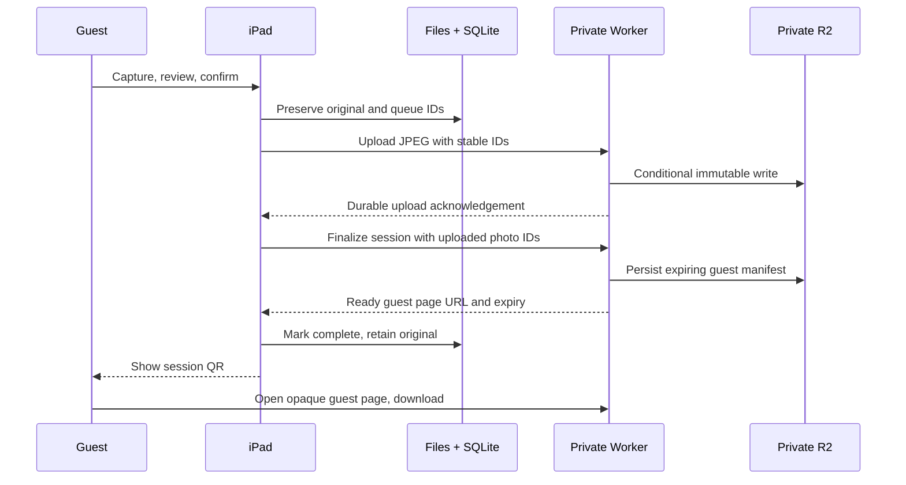

# Architecture

## Native app and session flow

The M1 iPad has ample capability for a digital-only booth. Expo / React Native was chosen to keep a real native iOS camera and persistent filesystem while allowing the cloud host to test shared TypeScript and produce an iOS JavaScript bundle. SwiftUI is a valid alternative, but this Linux host cannot validate Apple frameworks. The starter contains no web-app substitute.

Five photos form one guest session. A host-adjustable countdown drives capture, with a nearly full-screen preview, durable thumbnail progress, swipe review and individual retakes. Every shot is verified locally immediately; confirmation freezes the five selected IDs/order and enqueues their uploads. Retake originals are preserved. File journals reconstruct the local session independently of SQLite, and document-relative paths survive a changed iOS container prefix. The upload index is repairable rather than a prerequisite for saving. Originals are never automatically deleted.

The OS-authenticated local library exposes saved sessions without a network. A separate add-only Photos export stores additional copies when permission permits; denied/failed export does not invalidate the app's original. Generated attract imagery is fixed promotional art, never a slideshow of previous guests. Actual camera, filesystem protection and Photos permission behavior still require physical-device validation.

The foreground consumer retries with capped exponential backoff, resumes on app activation, and preserves pending work across process restarts. It does not promise background execution after iOS suspends or force-quits the app. A booth host should reopen the app and verify the pending count after any interruption.

If upload or finalization fails, the app keeps the same IDs and retries; it does not show a working remote link. A termination after remote acceptance can safely replay the operation. A QR is suppressed when its link expires, and starting the next guest clears the previous session from the display. A local emulator URL is never presented as a remotely accessible guest link.

## Backend contract

Booth `/v1` endpoints require the device bearer, compared through fixed-length SHA-256 digests with Workers' timing-safe equality. The one-use pairing consume endpoint instead requires a short-lived high-entropy private code; issuing that code requires the existing booth bearer. The app prefills its HTTPS origin and stores the paired credential in device-only Keychain after local host authentication. It contains no master/account/SMS/signing secret. Pairing transfers the same shared booth authority, not separate device administration. Rotate a lost device's token to revoke all paired copies. See [the protocol](BACKEND_PROTOCOL.md).

| Endpoint | Purpose |
| --- | --- |
| `GET /health` | Runtime health and mode |
| `POST /v1/pairing/codes` | Authenticated, short-lived private setup-code issuance |
| `POST /v1/pairing/consume` | Atomic one-use private-code exchange |
| `PUT /v1/sessions/:sessionId/photos/:photoId` | Private idempotent JPEG upload, bounded to 10 MiB |
| `POST /v1/sessions/:sessionId/ready` | Finalize an immutable uploaded photo list; return ready URL |
| `GET /g/:token` | Guest HTML gallery for one session |
| `GET /g/:token/photos/:photoId?download=1` | Full-resolution scoped download |
| `DELETE /v1/sessions/:sessionId/gallery` | Permanently revoke that gallery |
| `POST /v1/shares` | Consented mock/test/live provider boundary, live approval-gated |

R2 contains private JPEGs and manifests. Public bucket access and `r2.dev` remain disabled. HMAC capabilities map to hashed manifests; no browse-all/listing endpoint exists. Downloads use private/no-store, no-referrer, noindex and content-type protections. Disable logging of capability paths and request bodies. The Textbelt adapter uses a backend-only key, explicit eligibility/live approval and consent, with a durable session-level send fence. Uncertain outcomes never resend automatically, and provider acceptance never claims delivery. Tests intercept all provider traffic; mocks send nothing. The protocol records retry, retention and rotation limits.

The production example recommends seven days of guest access (`LINK_TTL_SECONDS=604800`), configurable between 60 seconds and 30 days; the local/default value remains 24 hours. The iPad displays the acknowledged expiry in device-local date/time/timezone, and the gallery displays an exact UTC expiry. Expiring or revoking a link does not delete the couple's original. Before launch, choose original retention, host export/backup procedure, and deletion timing. Possession of the bearer link permits viewing/downloading its session; it can be forwarded and does not establish guest identity.

Every route that can reach R2 passes native rate protection before storage lookups. Fixed gallery/photo/API/share band limits, hashed trusted-client scopes and hashed gallery-token scopes prevent path/query/token rotation from resetting the shared budgets. All eight production bindings are required; missing bindings, invalid results or limiter failures deny storage access. Local tests may omit the entire policy, while the normal local Wrangler configuration emulates the native bindings. These counters are approximate and per Cloudflare location: distributed traffic can still incur charges, and they are not a globally coordinated budget or storage cap. Review namespace IDs, account-plan support and financial controls before deployment. No rate-limit resources or plan changes were provisioned here.

## Production boundary

The local config uses published, non-secret development values and fails closed outside loopback. The production EXAMPLE config is not a deployable account setup: it has no account ID, routes, bucket provisioning, or live secrets. It proposes only a dedicated `photos.gizelleandrami.com` Worker. Do not modify the existing `gizelleandrami` Worker, apex, `www`, or shared site resources.

The owner activated R2 and created the existing private bucket `gizelleandrami-photoboothphotos`; privacy settings were verified read-only by the coordinating task. Use that exact bucket through a dedicated Worker-to-R2 binding instead of adding S3 credentials to the app. Do not create a duplicate bucket. The production example disables invocation logs, traces, persistence and sampling; the deployment metadata also disables Logpush and tail consumers. Verify these live controls rather than relying on query-string redaction. Rate controls are implemented locally but have not been deployed or verified at the edge. This MVP does not contain a hard worldwide spending cap, managed per-device enrollment, automatic device backup, image decoding/transcoding, or an automated website importer. Verify upload size limits against real iPad JPEGs before public launch.

## Open-source reuse

The bounded choice is to retain the working Expo/React Native foundation and use maintained focused modules, rather than migrate to an unrelated booth app after queue/API validation. Expo and React Native are MIT-licensed; `react-native-svg` and `react-native-qrcode-svg` provide permissively licensed native vector/QR rendering; Wrangler/Miniflare provide Cloudflare's local runtime. Versions and registry integrity hashes are pinned in the lockfile. No proprietary booth assets or unlicensed application source are copied. Inspect the installed package license files and dependency advisories before release; these components do not promise ongoing security support. The original project license is preserved.

There is no enabled Google Cloud/Firebase dependency. Firebase Test Lab may be useful once signed native UI test artifacts exist; it cannot test this iPad camera through JavaScript unit tests. Do not replace a physical booth rehearsal with cloud-emulator results.
