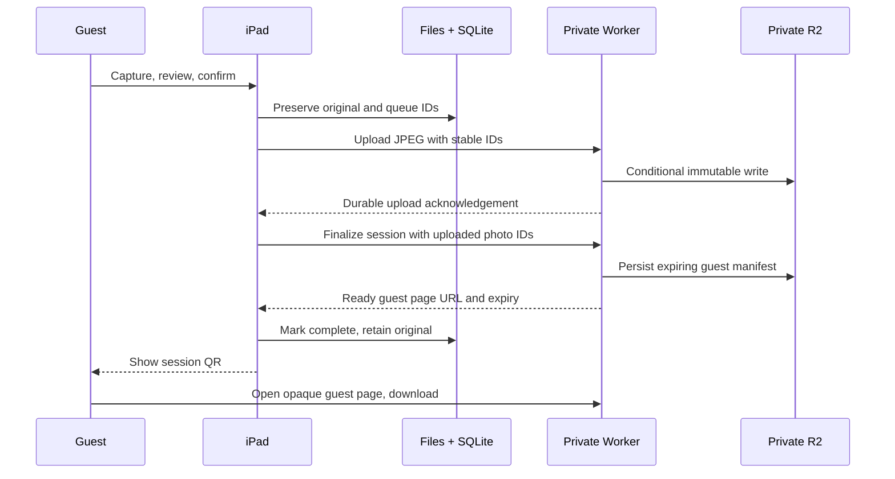

# Architecture

## Native app and session flow

The M1 iPad has ample capability for a digital-only booth. Expo / React Native was chosen to keep a real native iOS camera and persistent filesystem while allowing the cloud host to test shared TypeScript and produce an iOS JavaScript bundle. SwiftUI is a valid alternative, but this Linux host cannot validate Apple frameworks. The starter contains no web-app substitute.

One confirmed photo forms a guest session in this MVP. Capture uses the front camera, a countdown, preview and retake. Retakes remain local drafts; confirmation durably preserves the original and enqueues an upload. The SQLite queue uses stable photo/session IDs. Photo files are staged and renamed; confirmed files can rebuild a missing queue entry after termination. Originals are not automatically deleted.

The foreground consumer retries with capped exponential backoff, resumes on app activation, and preserves pending work across process restarts. It does not promise background execution after iOS suspends or force-quits the app. A booth host should reopen the app and verify the pending count after any interruption.

If upload or finalization fails, the app keeps the same IDs and retries; it does not show a working remote link. A termination after remote acceptance can safely replay the operation. A QR is suppressed when its link expires, and starting the next guest clears the previous session from the display. A local emulator URL is never presented as a remotely accessible guest link.

## Backend contract

All `/v1` endpoints require the device bearer token. IDs are UUIDs. The token is operator-entered and held in the iOS Keychain; it is not an Expo public environment variable. A production version requires distinct high-entropy server secrets and a configured HTTPS public origin. Device tokens are narrowly for booth upload/sharing; host administration and multi-device enrollment are future hardening work. Rotate a lost device's token immediately.

| Endpoint | Purpose |
| --- | --- |
| `GET /health` | Runtime health and mode |
| `PUT /v1/sessions/:sessionId/photos/:photoId` | Private idempotent JPEG upload, bounded to 10 MiB |
| `POST /v1/sessions/:sessionId/ready` | Finalize an immutable uploaded photo list; return ready URL |
| `GET /g/:token` | Guest HTML gallery for one session |
| `GET /g/:token/photos/:photoId?download=1` | Full-resolution scoped download |
| `DELETE /v1/sessions/:sessionId/gallery` | Permanently revoke that gallery |
| `POST /v1/shares` | Consented provider boundary; mock only at present |

R2 contains private JPEGs and manifests. Public R2 bucket access and `r2.dev` must remain disabled. Random-looking HMAC capabilities map to hashed-token manifests; there is no browse-all or public listing endpoint. Download responses use private/no-store, no-referrer, noindex and content-type protections. Avoid analytics on capability URLs and redact them from infrastructure logs. Server mocks do not retain raw phone numbers or send network requests to an SMS provider. Share IDs protect retries; mock failure remains a failure rather than a sent state.

Guest-link expiry defaults to 24 hours; `LINK_TTL_SECONDS` is separately configurable. Expiring or revoking a link does not delete the couple's original. Before launch, choose guest access duration, original retention, host export/backup procedure, and deletion timing. A link can be forwarded and is not guest identity authentication.

## Production boundary

The local config uses published, non-secret development values and fails closed outside loopback. The production EXAMPLE config is not a deployable account setup: it has no account ID, routes, bucket provisioning, or live secrets. It proposes only a dedicated `photos.gizelleandrami.com` Worker. Do not modify the existing `gizelleandrami` Worker, apex, `www`, or shared site resources.

The owner activated R2 and created the existing private bucket `gizelleandrami-photoboothphotos`; privacy settings were verified read-only by the coordinating task. Use that exact bucket through a dedicated Worker-to-R2 binding instead of adding S3 credentials to the app. Do not create a duplicate bucket. Add an edge rate limit/request budget and verify upload size limits against real iPad JPEGs before public launch. This MVP does not contain a production abuse-control deployment, managed per-device enrollment, automatic device backup, image decoding/transcoding, or an automated website importer.

## Open-source reuse

The bounded choice is to retain the working Expo/React Native foundation and use maintained focused modules, rather than migrate to an unrelated booth app after queue/API validation. Expo and React Native are MIT-licensed; `react-native-svg` and `react-native-qrcode-svg` provide permissively licensed native vector/QR rendering; Wrangler/Miniflare provide Cloudflare's local runtime. Versions and registry integrity hashes are pinned in the lockfile. No proprietary booth assets or unlicensed application source are copied. Inspect the installed package license files and dependency advisories before release; these components do not promise ongoing security support. The original project license is preserved.

There is no enabled Google Cloud/Firebase dependency. Firebase Test Lab may be useful once signed native UI test artifacts exist; it cannot test this iPad camera through JavaScript unit tests. Do not replace a physical booth rehearsal with cloud-emulator results.
