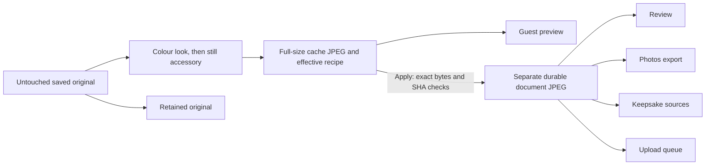

# Post-capture accessories — isolated review candidate

Branch `codex/post-capture-face-effects` contains candidate **0.3.8/build11**. It is based on the stable MVP handoff `642a367`; the installed `9ed36b4` /0.3.7 build10 is unchanged. **No merge, deployment, signing change or installation is approved by this document.**

The reviewed still renderer from exact `9335c18` is copied into the existing local photo module. No camera, countdown, full-original camera patch, device orientation or sharing-provider changes are required. This feature is optional after capture, with **None** as the default. It does not provide live tracking.

## One approved file through the workflow

Choosing an edit renders from the root original. Apply copies the **same acknowledged preview file**, rather than rendering again or substituting another same-recipe image. The original and copied output SHA-256 are checked before the selection journal commits. A previously committed variant may be reused only when that exact ID/URI was previewed. Reopening it needs no native render.

The versioned recipe records `look-then-face`. Colour processing shares the existing Core Image look implementation, with no intermediate JPEG. Vision and accessories run on the resulting upright pixels; accessory colours remain intact. Nonidentity output is a fresh full-size sRGB JPEG without source GPS/EXIF. Identity returns the untouched original, including its existing metadata. Original files remain byte-identical. Each selected derivative keeps its root `sourcePhotoId`, so raw originals and primary edited downloads retain their existing separate roles.

## Safe choices and recovery

- None removes only the accessory, preserving a colour look. Identity recipes return the exact original URI.
- No face or no safe placement produces an effective None recipe, preserving any colour look. The UI explains the fallback. A partial placement reports its actual count without claiming all faces were decorated.
- Rapid changes cancel native work and wait for its acknowledgement before starting the latest choice. Stale results cannot replace the preview or enter a new guest's session.
- New derivative journals are never eligible for automatic selection. Copy, rename, hash, cancellation or journal failures retain original/host-recoverable bytes while leaving the previous selection in place. An admitted selection journal that already committed is recovered truthfully.
- Old four/five-photo and look-only sessions remain supported. A recovered legacy root can stay at `.draft.jpg` if its original rename cannot complete; treatment verification checks only that root ID's bounded JPEG paths and exact stored SHA, without renaming or promoting the original.
- Photos uses the selected durable URI and retains the existing uncertainty/deduplication rules. Unconfirmed or abandoned retake derivatives do not become upload jobs. Completed upload IDs and acknowledgement state remain unchanged during repair.
- Native cache leases prevent a new module instance from deleting another live instance's preview or in-progress temporary file. Releases remain confined to this engine's cache UUIDs.

## Review evidence and limits

The frozen local candidate passed **536 product tests, 149 CI contract tests, all workspace typechecks and an iOS Hermes export**, with no failed/skipped tests. The independent browser acceptance run passed **23 groups** and produced **30 screenshots** in both orientations; all 537 historical visual files remain unchanged. See [test record](../artifacts/test-results/post-capture-face-local.json), [UI evidence index](../artifacts/visual/face-effects-index.html) and [parity review](../artifacts/visual/face-effects-parity-review.md). Hosted results are recorded separately below.

Current local evidence includes 61 editor cases (21 unchanged legacy), 96 persistence/files/SQLite cases, six UI-message truth cases and two composed real-file routing cases. The routing cases verify cache/document/Photos-port/keepsake-source/upload-port byte identity and cancellation during a real copy. Native rendering, Photos, template raster and transport are substituted only at those test boundaries; they do not prove device behavior.

The hosted treatment pixel profile requires **29 real iOS simulator XCTest cases**: the original eight look and eleven template cases plus ten treatment cases. It also requires all **19 native JPEGs** (16 existing +3 treatment outputs), exact source/copy hashes and the unchanged generated PNG. The default pixel graph and full-app 20-case runtime gate remain separate. An unsigned nonfixture Release build checks the real module and bundled JS; compilation alone is not bridge/camera/Photos runtime proof.

Actual Root browser screenshots use explicitly labeled native-port substitutes and do not fabricate successful accessory pixels. Inspect the actual native treatment JPEGs for effect appearance. Physical iPad camera/Photos behavior, sustained latency/memory/thermal performance, real venue use and an owner-approved installation remain open. Cloud pairing and SMS remain independent; these tests send no real messages or photos to production.

Before proposing integration, review local/hosted results, inspect native output and both-orientation UI evidence, then complete the actual iPad rehearsal on a separately approved build. Preserve the stable wedding build throughout.

## Device acceptance after separate review and installation approval

The existing physical smoke runner checks capture/relaunch, not these accessories. Do not count its success as treatment acceptance or arm it automatically.

1. Preserve the installed app identity and all saved sessions. Use an approved harmless test subject; do not upload private photos or enable SMS as part of this check.
2. In a new four-photo review, choose Warm and an accessory. Wait for the actual rendered image, inspect both people/edges, then Apply. Compare the review image with the newly added Photos copy and the keepsake preview/export.
3. Reopen the edit and select None. Confirm the colour look remains and the untouched original is still available through host recovery. Cancel a different edit and confirm the selected photo stays unchanged.
4. Change choices rapidly, background during processing, and relaunch after an admitted save. Check that the selected derivative and recipe return, with no stale image, wrong guest or automatic selection of an abandoned result.
5. Check a no-face subject and a touching-head pair. None/fallback must remain usable and truthful; never force an accessory over another person's face. Check device rotation, unmirrored saved orientation and both layouts.
6. Rehearse individual and whole-session retakes, interruption and offline use without deleting prior originals. Measure actual response time and sustained memory/thermal behavior before enabling the option for wedding guests.

The first hosted Linux run (`40511920808`, source `9fa06d7`) stopped in physical-runner preparation contracts: its production guard intentionally accepted only 0.3.7/build10. The candidate retains that review and adds an exact 0.3.8/build11 and complete UI-source hash entry after source review. Unknown versions/builds or changed UI bytes remain rejected. Signing is disabled and readiness is still explicitly `NOT_ARMED`; this is unsigned source preparation, not authorization to install or run the candidate. All 149 complete preflight/treatment contracts pass locally after the repair.

## Actual Apple result and diagnostic follow-through

At source `6492010409d499399277ce9d0ecea6c911a1acc4`, hosted [Linux verification](https://github.com/Xare123/WeddingIpadPhotoboothApp/actions/runs/40512638138) and the [unsigned iPhoneOS Release build](https://github.com/Xare123/WeddingIpadPhotoboothApp/actions/runs/40512638110) passed. The [iOS pixel run](https://github.com/Xare123/WeddingIpadPhotoboothApp/actions/runs/40512638049) executed all 29 methods: **27 passed, two failed, none skipped**. All 19 native JPEGs were exported. The candidate does **not** pass native acceptance.

The public annotation identifies separated-pair Warm/glasses assertions: one decorated face instead of two, with partial instead of complete placement. The other failed method must be identified from the full result inventory; the first two assertion lines do not establish its identity. This pure Swift failure occurs before Expo/JavaScript conversion. PNG/JPEG conversion, colour processing and iOS/macOS Vision differences remain hypotheses, not established causes.

A test-only follow-up compares raw PNG, decoded root JPEG and the exact Warm pixel path on one iOS runtime. It emits bounded, SHA-guarded **fictional-fixture-only** geometry and actual unchanged placement results into `xcode-test.log` under indexed `SYNTHETIC_FACE_PLACEMENT_JSON_CHUNK i/n` lines of at most 6,000 payload bytes (concatenate payloads in order), with an attachment named `synthetic-face-placement-diagnostic`. All copied production sources and acceptance assertions remain unchanged. This diagnostic is not a fix or a claim of two-person success. The existing browser evidence fingerprints the earlier native test source; App, native production code and all browser-rendered inputs are unchanged.

The diagnostic-only revision `316ce2daf31e2149168c954ba1cb3bd1e0e881df` completed [Linux verification](https://github.com/Xare123/WeddingIpadPhotoboothApp/actions/runs/40516218265) successfully. Its [iOS run](https://github.com/Xare123/WeddingIpadPhotoboothApp/actions/runs/40516218241), job `122230704240`, again executed 29 methods: **27 passed, two failed, zero skipped; 19 JPEGs exported**. All 19 baseline methods passed. The failed methods are:

- `NativePhotoTreatmentEngineTests.testActualSeparatedPortraitDecoratesBothPeopleAfterLookWithoutReencodingIntermediate`
- `NativePhotoTreatmentEngineTests.testLookNoneMatchesExistingEnginePixelsAndRecipeOrderKeepsVectorColors`

The native production files, app and bridge are byte-identical to the successful unsigned Release revision. The Release lane was intentionally skipped for the diagnostic-only change. No production fix, merge, deployment or installation was performed.

### Exact blocker and next evidence

The executor could read public run status/annotations and initially read authenticated GitHub metadata. Official artifact downloads were denied with **Forbidden** at `productionresultssa4.blob.core.windows.net`; the official job-log read was denied at `results-receiver.actions.githubusercontent.com`. After an automatic executor recovery, the final `api.github.com` metadata read was also denied. Downloads did not complete; no alternate proxy, host, credential extraction or network grant was used.

An authorized coordinator must inspect the full assertion messages for the second method, the synthetic JSON chunks in `xcode-test.log` (or the JSON attachment), and the three actual treatment JPEGs. The retained artifact names are `native-pixels-evidence-316ce2daf31e2149168c954ba1cb3bd1e0e881df` and `native-pixels-jpegs-316ce2daf31e2149168c954ba1cb3bd1e0e881df`. Use an already authorized supported connector or an approved managed-access remedy. Do not repeat the unchanged run, relax protection/assertions, or infer a geometry/encoding fix from the two known method names alone.

The isolated candidate remains held. The installed wedding app remains 0.3.7/build10. Environment draft revision 30 still pins stable source `642a3676a4993ec9880f44e45ee2b6b48aaf7a8d`; it was not repinned to this experimental branch. Snapshot publication/fresh restoration is not established by these checks.

## Same-observation follow-up

The coordinator relayed synthetic measurements from its artifact copy acquired legitimately before the executor denial; no new transfer was performed. All three independent variants had confidence 1, all common admission flags true, no obstruction rectangles and two placements per style, while the production Warm/glasses receipt had one. Face boxes were stable but measured eye distances/roll changed sharply. The coordinator also observed small displaced glasses/crown and absent hearts in actual native output. These observations establish a real discrepancy; they do not establish its cause.

The observed CLI failure form was a Go URL transport error (`Get "https://…": Forbidden`), not an authenticated GitHub resource-permission response. The startup proxy policy is restricted and its 144 exact host rules contain none of the three denied hosts, with no wildcard rule. This is consistent with a proxy destination-policy rejection; runtime policy enforcement is reported as unknown, so the precise enforcement decision and the separate connector's authorization are not proven. No further artifact/log reads or network-grant changes are part of this follow-up.

The next test-only run publishes a **minimal generated-fixture numeric summary through normal existing CI output**, as authorized by the coordinator. It adds no HTTP request or new CI permission. A strict parser admits only the pinned fixture SHA, four fixed variant names, bounded numbers/booleans/null and known failure enums. Other fields/payloads are rejected without echo. All 155 local contract checks pass; the app, production Swift and acceptance assertions remain unchanged.

For each of PNG, decoded JPEG, Warm and B&W, this compares the manual eye projection with Apple's `pointsInImage(imageSize:)` on the same observations. The handler stays explicitly alive while whole-eye values are copied; the request/landmarks/regions stay alive after handler release. Whole-array and per-point rereads are compared with those snapshots. There are no extra repeat inference requests or enlarged timeouts. The ordering case retains the reference worker's full `Result` and reports it before any JPEG unwrap.

Public summary fields are deliberately small:

- `b`, `e`, `appleE`: face box, manual eyes and Apple-converted eyes in **normalized top-left image coordinates**.
- `appleDeltaMax`: manual face-box projection versus Apple conversion; `directDeltaMax`: unprojected normalized points versus Apple conversion, normalized by image size.
- `normalizedRepeatDelta`: maximum same-region coordinate change across before/after handler release and getter patterns; null means a required comparison was unavailable. `handlerReleased` reports actual weak-reference disappearance.
- `landmarkConfidence` is separate from detection confidence `c`. `admissionBits` uses six bits for confidence ≥0.5, minimum face width, eyes inside box, minimum eye distance, distance within face width and supported roll.
- `g`, `c`, `h` counts mean glasses, crown and hearts placements. `canonicalFull` uses Apple-converted anchors with the same unchanged safety geometry; no resulting image is substituted for the production render.
- The ordering summary distinguishes `success`, `failure` and `absent`; `referenceJpegPresent` and `goldPixelCount` are observed independently.

Native SDK compilation and these measurements are pending. A coordinate/lifetime change requires evidence from this comparison; normal summaries do not change the required 29 passing cases or 19 JPEGs.
