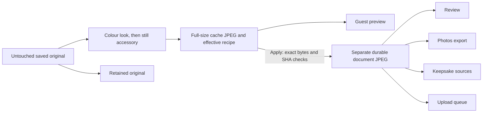

# Post-capture accessories — isolated review candidate

Branch `codex/post-capture-face-effects` contains candidate **0.3.8/build11**. It is based on the stable MVP handoff `642a367`; the installed `9ed36b4` /0.3.7 build10 is unchanged. **No merge, deployment, signing change or installation is approved by this document.**

The reviewed still renderer from exact `9335c18` is copied into the existing local photo module. No camera, countdown, full-original camera patch, device orientation or sharing-provider changes are required. This feature is optional after capture, with **None** as the default. It does not provide live tracking.

## One approved file through the workflow

Choosing an edit renders from the root original. Apply copies the **same acknowledged preview file**, rather than rendering again or substituting another same-recipe image. The original and copied output SHA-256 are checked before the selection journal commits. A previously committed variant may be reused only when that exact ID/URI was previewed. Reopening it needs no native render.

The versioned recipe records `look-then-face`. Colour processing shares the existing Core Image look implementation, with no intermediate JPEG. Vision and accessories run on the resulting upright pixels; accessory colours remain intact. Nonidentity output is a fresh full-size sRGB JPEG without source GPS/EXIF. Identity returns the untouched original, including its existing metadata. Original files remain byte-identical. Each selected derivative keeps its root `sourcePhotoId`, so raw originals and primary edited downloads retain their existing separate roles.

## Safe choices and recovery

- None removes only the accessory, preserving a colour look. Identity recipes return the exact original URI.
- No face or no safe placement produces an effective None recipe, preserving any colour look. The UI explains the fallback. A partial placement reports its actual count without claiming all faces were decorated.
- Rapid changes cancel native work and wait for its acknowledgement before starting the latest choice. Stale results cannot replace the preview or enter a new guest's session.
- New derivative journals are never eligible for automatic selection. Copy, rename, hash, cancellation or journal failures retain original/host-recoverable bytes while leaving the previous selection in place. An admitted selection journal that already committed is recovered truthfully.
- Old four/five-photo and look-only sessions remain supported. A recovered legacy root can stay at `.draft.jpg` if its original rename cannot complete; treatment verification checks only that root ID's bounded JPEG paths and exact stored SHA, without renaming or promoting the original.
- Photos uses the selected durable URI and retains the existing uncertainty/deduplication rules. Unconfirmed or abandoned retake derivatives do not become upload jobs. Completed upload IDs and acknowledgement state remain unchanged during repair.
- Native cache leases prevent a new module instance from deleting another live instance's preview or in-progress temporary file. Releases remain confined to this engine's cache UUIDs.

## Review evidence and limits

The frozen local candidate passed **536 product tests, 149 CI contract tests, all workspace typechecks and an iOS Hermes export**, with no failed/skipped tests. The independent browser acceptance run passed **23 groups** and produced **30 screenshots** in both orientations; all 537 historical visual files remain unchanged. See [local test record](../artifacts/test-results/post-capture-face-local.json), [UI evidence index](../artifacts/visual/face-effects-index.html) and [parity review](../artifacts/visual/face-effects-parity-review.md). Native hosted results are pending the exact-commit run and must be recorded separately.

Current local evidence includes 61 editor cases (21 unchanged legacy), 96 persistence/files/SQLite cases, six UI-message truth cases and two composed real-file routing cases. The routing cases verify cache/document/Photos-port/keepsake-source/upload-port byte identity and cancellation during a real copy. Native rendering, Photos, template raster and transport are substituted only at those test boundaries; they do not prove device behavior.

The hosted treatment pixel profile requires **29 real iOS simulator XCTest cases**: the original eight look and eleven template cases plus ten treatment cases. It also requires all **19 native JPEGs** (16 existing +3 treatment outputs), exact source/copy hashes and the unchanged generated PNG. The default pixel graph and full-app 20-case runtime gate remain separate. An unsigned nonfixture Release build checks the real module and bundled JS; compilation alone is not bridge/camera/Photos runtime proof.

Actual Root browser screenshots use explicitly labeled native-port substitutes and do not fabricate successful accessory pixels. Inspect the actual native treatment JPEGs for effect appearance. Physical iPad camera/Photos behavior, sustained latency/memory/thermal performance, real venue use and an owner-approved installation remain open. Cloud pairing and SMS remain independent; these tests send no real messages or photos to production.

Before proposing integration, review local/hosted results, inspect native output and both-orientation UI evidence, then complete the actual iPad rehearsal on a separately approved build. Preserve the stable wedding build throughout.

The first hosted Linux run (`40511920808`, source `9fa06d7`) stopped in physical-runner preparation contracts: its production guard intentionally accepted only 0.3.7/build10. The candidate retains that review and adds an exact 0.3.8/build11 and complete UI-source hash entry after source review. Unknown versions/builds or changed UI bytes remain rejected. Signing is disabled and readiness is still explicitly `NOT_ARMED`; this is unsigned source preparation, not authorization to install or run the candidate. All 149 complete preflight/treatment contracts pass locally after the repair.
